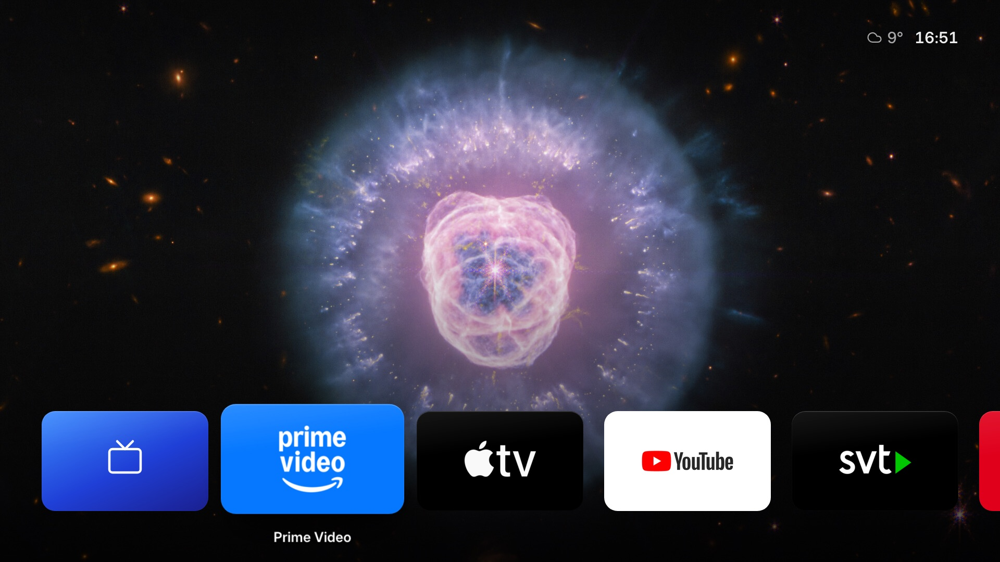
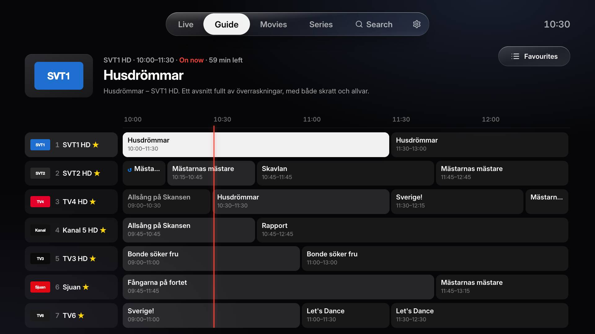
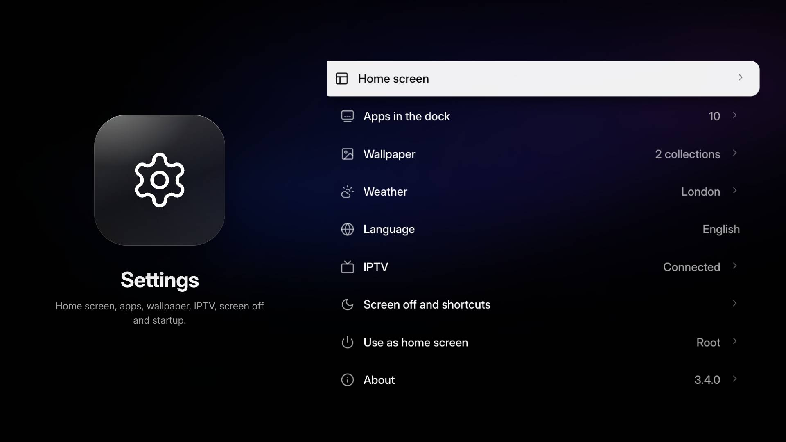

# iptvOS

**iptvOS** is a custom home screen for LG webOS TVs in the style of tvOS 26 ("Liquid Glass"), with built-in IPTV (live TV, guide, movies, series, search) and an optional hub that runs on your own server. It replaces LG's home screen on a rooted TV. The interface is in **English** and **Swedish** and follows the TV's language.

**[Svenska](README.sv.md)** · [Architecture](docs/ARCHITECTURE.md) · [The hub](hub/README.md) · [For AI agents](AGENTS.md)







> **No content included.** This is a home screen and a player. It ships no channels, playlists or streams and does not link to any. For IPTV you need your own subscription from a provider you are allowed to use. Rooting a TV is at your own risk and may void its warranty.

## Contents

- [What you need](#what-you-need)
- [With or without the hub](#with-or-without-the-hub)
- [Install](#install)
- [The home screen](#the-home-screen)
- [The TV app](#the-tv-app)
- [Development](#development)
- [Commands](#commands)
- [Troubleshooting](#troubleshooting)
- [License](#license)

## The parts

| Part | Where | What |
| --- | --- | --- |
| **The launcher** | `apps/launcher` | Home screen, TV app and settings (a web app on the TV) |
| **The service** | `apps/launcher/service` | Runs as root on the TV: app list, HDMI inputs, icons, start at power-on, reminders |
| **The hub** (optional) | `hub/` | The IPTV brain on a small server, for example a Proxmox LXC: playlists, category selection, favourites, search, artwork and a web admin. See [hub/README.md](hub/README.md). |

How the parts talk to each other is described in [docs/ARCHITECTURE.md](docs/ARCHITECTURE.md).

## What you need

### The TV

- **An LG webOS TV.** Developed and tested on an LG OLED G3 (OLED65G36LA) with current firmware. Other recent LG webOS TVs will probably work, but are untested. Reports are welcome.
- **Root and the Homebrew Channel.** The launcher replaces LG's home screen, starts when the TV is switched on and reads the TV's real app list and inputs. LG only allows that for apps with root access, so the TV must be rooted and have the [Homebrew Channel](https://github.com/webosbrew/webos-homebrew-channel) installed.

  This project does not root TVs and does not describe how to. Whether a TV can be rooted depends on its model and firmware version, and the methods change over time. Use the webOS Homebrew Project's own, up-to-date resources:

  | Question | Where |
  | --- | --- |
  | Can my TV be rooted? | [CanI.RootMy.TV](https://cani.rootmy.tv/), which checks your model and firmware |
  | How do I root it? | [webosbrew.org/rooting](https://www.webosbrew.org/rooting/), the official guide |
  | What is the Homebrew Channel? | [webosbrew.org](https://www.webosbrew.org/) and [its GitHub page](https://github.com/webosbrew/webos-homebrew-channel) |

- **SSH in the Homebrew Channel.** Turn on the SSH server in the Homebrew Channel's settings. Installing and the one-time root step run over SSH as `root` on port 22. Set up a password or key as the Homebrew Channel describes.
- **The TV's IP address.** Give the TV a fixed address in your router so the computer and the hub can always find it.

### Homebrew apps

Install them from the Homebrew Channel on the TV.

| App | Needed? | What for |
| --- | --- | --- |
| **Homebrew Channel** | Required | Root, SSH and startup scripts (`init.d`). The launcher's watcher script lives there. |
| **[LG Input Hook](https://repo.webosbrew.org/apps/org.webosbrew.inputhook)** (`org.webosbrew.inputhook`) | Recommended | Lets the remote's **Home** button open this launcher instead of LG's. It is also used for an optional "screen off" button that works in any app. |

### On your computer

- **Node.js 18 or later** with npm, and git. Used to build, test and install.
- **[webOS Dev Manager](https://github.com/webosbrew/dev-manager-desktop)** (optional). If you add the TV there (user `root`, port 22), `npm run tv` finds it automatically. Without it, run `npm run tv -- setup <tv-ip> root` once.
- **Google Chrome** (optional) for `npm test`, which drives the UI in a headless browser.

### For IPTV (optional)

The launcher works as a home screen without any IPTV at all. For the TV app you need one of these:

- **An Xtream Codes account** from your provider (server, username, password). It works both with and without the hub.
- **An M3U playlist URL**. This needs the hub.

For the hub you need a small always-on machine on your network with Node.js 18 or later, for example a Proxmox container (a script is included), a Raspberry Pi or a NAS.

## With or without the hub

| | Without the hub (direct) | With the hub |
| --- | --- | --- |
| Home screen, apps, inputs, settings, wallpapers, screensaver | ✓ | ✓ |
| Live TV, guide, catch-up, reminders | ✓ | ✓ |
| Movies and series, "Continue watching", search | ✓ | ✓ |
| Provider types | Xtream Codes | Xtream Codes and M3U, several playlists |
| Choosing categories and favourites | On the TV | On the TV and in a web admin, shared by all TVs |
| Very large playlists (20,000+ channels) | The TV downloads and sorts everything | The hub caches; the TV loads only what you show |
| Posters for titles without artwork (TMDB) | – | ✓ (with a free TMDB key) |
| Subtitles inside `.mkv` files drawn by the launcher | – (the TV's own subtitles) | ✓ |
| Wallpaper collections | Glass and a small space set | About 3,600 more images in six collections |
| Aerial videos as screensaver | – | ✓ |

Start without the hub if you have an Xtream Codes account and a normal-sized playlist. You can add the hub later. Under Settings › IPTV you choose **Hub** or **Direct**.

## Install

Steps 1–3 install the launcher. Steps 4–6 are optional.

1. **Get the code and install the tools:**
   ```bash
   git clone https://github.com/Creazawolf/iptvOS.git
   cd iptvOS
   npm install
   ```
2. **Connect to the TV.** Either add it to webOS Dev Manager (user `root`, port 22), or run:
   ```bash
   npm run tv -- setup 192.168.1.50 root     # your TV's IP address
   npm run tv -- device                      # shows which TV will be used
   ```
   With several TVs, choose one with `TV_DEVICE=<name>`.
3. **Install and give the service root (once).** The app shows up as **iptvOS** in LG's app list.
   ```bash
   npm run deploy          # build, install over SSH and start
   npm run tv -- root      # one time: root and start at power-on
   ```
   `npm run tv -- root` puts a small watcher script in the Homebrew Channel's `init.d`. It lets the Homebrew Channel lift the launcher's service to root, which a normal developer app cannot do, and it does so again after every restart and every reinstall. It also starts the launcher when the TV is switched on or wakes from standby. Without a computer, the same command is shown on the TV under Settings › Use as home screen, and you can run it as root on the TV over SSH.
4. **The Home button (recommended).** Install **LG Input Hook** from the Homebrew Channel. Bind the **Home** button to *Execute* with this command, which is also shown under Settings › Use as home screen › Home button:
   ```sh
   luna-send -n 1 luna://com.webos.applicationManager/launch '{"id":"com.g3custom.launcher","keepAlive":true}'
   ```
   `keepAlive` asks the TV not to close the launcher when memory is short, so the Home button finds it ready. The watcher starts LG Input Hook after every restart, since it doesn't do that itself. If Input Hook says root is missing, see [Troubleshooting](#troubleshooting).
5. **IPTV.** On the TV, open Settings › IPTV:
   - **Direct:** enter your Xtream Codes server, username and password.
   - **Hub:** first set up the hub ([hub/README.md](hub/README.md)). Then enter its address, for example `http://192.168.1.20:8787`. You manage playlists, categories and favourites in the hub's web admin.
6. **Screen off from any app (optional).** Under Settings › Screen off and shortcuts › Screen off button, press the remote button you want to use. From the computer, `npm run tv -- key` shows the code of the next button you press, and `npm run tv -- key <code>` binds it. This needs LG Input Hook.

`npm run tv -- status` shows the state on the TV: root, the watcher, LG Input Hook and which app is in front.

**Language.** The interface follows the TV's menu language: Swedish if the TV is set to Swedish, otherwise English. Change it under Settings › Language. The hub's web admin follows your browser, and you can change it there too.

**Personal defaults.** Copy `apps/launcher/config.local.example.js` to `apps/launcher/config.local.js` to set your own defaults, for example the weather location, the dock apps or IPTV details. That file is not committed, but it is included when you deploy. What you change on the TV is saved on the TV and wins over both files.

**Turn it off or remove it.** Turn off "Start at power-on" in the settings: the service keeps root, but the launcher no longer starts by itself. To remove everything, run this as root on the TV:
```sh
sh /var/lib/webosbrew/init.d/90-g3custom stop; rm /var/lib/webosbrew/init.d/90-g3custom
```
Then uninstall the app from the TV or with webOS Dev Manager.

## The home screen

- **The dock** at the top has your favourite apps and inputs. Choose them under Settings › Apps in the dock, or hold OK on an app.
- **The top shelf** shows the wallpaper. On the TV tile it shows a silent preview of the last channel with "Continue watching" instead. Apps with their own artwork show it.
- **The rows below the dock** are Channels (your favourite channels and what's on now), Continue watching (movies and episodes) and All apps (every installed app and HDMI input). Under Settings › Home screen you choose which rows are shown and in what order.
- **Real apps and logos.** The app list comes from the TV, and the icons are the apps' own, in the highest resolution. HDMI devices get sharp logos (PlayStation, SHIELD, Xbox …) and the name from the TV, for example "PS5".
- **Clock and temperature** sit quietly in the top right. Choose the weather location under Settings › Weather.
- **Wallpapers.** Pick one or more collections under Settings › Wallpaper; they are mixed. Glass (abstract glass images, built in) is always there. With the hub you get about 3,600 more: Space (Webb, Hubble and ESO, CC BY 4.0), Earth from above (Google Earth View), Nature and landscapes and Featured pictures (Wikimedia Commons, photographers credited), Picture of the day (Bing) and Photographs (Chromecast backgrounds). The hub sends one image at a time at 1,920 px, so the TV does no heavy work.
- **Screensaver.** After a while without a button press, the wallpaper drifts slowly and a dimmed clock is shown. Under Settings › Wallpaper you can choose **Aerial videos** instead: slow flights over nature, cities, oceans and Earth from space, with the place's name and captions. The lists come from the [Aerial Views](https://github.com/theothernt/AerialViews) project. They stream in 1080p, 4K or 4K Dolby Vision and are never stored. After an hour, the images take over again so a TV left on doesn't stream video for nothing. The first button press ends it.
- **Performance mode** under Settings › Home screen turns off glass blur and shine.
- **Screen off** turns the picture off but keeps the sound, for music and podcasts. The tile is among the apps and in the dock.
- **LG webOS** is a tile that opens LG's own home screen. The Home button brings you back.

## The TV app

- **Nothing changes by itself.** On the tab row (Live · Guide · Movies · Series · Search), ◀ ▶ only moves the cursor; OK or ▼ opens the tab. In the channel list you browse freely: OK plays the channel in the preview, OK again goes full screen. You can change this under the gear › Navigation.
- **The gear** at the end of the tab row opens the TV app's settings: source, navigation, live TV, movies and series, audio and subtitles, reminders and clean-up.
- **Live** with channel list, guide and full screen. Holding ▲▼ only starts the channel you stop on. Channel numbers switch as soon as the number is unambiguous.
- **Catch-up:** on channels where the provider keeps recordings, past programmes are marked with ↺ in the guide. OK plays them, and *Watch from the start* is available for programmes that are on now (hold OK).
- **Reminders:** OK on an upcoming programme in the guide or in search results. A box appears on the TV a minute before, even if you're watching something else. *Watch now* switches channel.
- **Search** finds channels, movies, series and programmes in the guide.
- **Movies and series** continue where you left off and play the next episode. The TV plays the files with its own decoder, so 4K, HDR10, HLG, Dolby Vision, Dolby Atmos and DTS work when the file has them. Audio tracks and subtitles are chosen with the green button, where you can also change subtitle size, position, background and sync.
- **Back** from something you started on the home screen goes to the TV app. Back again goes to the home screen.

Buttons in full screen (live):

| Button | |
| --- | --- |
| ▲ ▼ / CH± | Change channel (or browse and switch with OK, see Navigation) |
| OK / ◀ | Channel list on top of the picture |
| Blue | Previous channel |
| Green | Audio and subtitles |
| Red | Options: aspect ratio, sleep timer, screen off, reminder for the next programme |
| Yellow | Favourite |
| 0–9 | Channel number |

In the movie player, green is Audio and subtitles and red is Options.

Buttons on the home screen:

| Button | |
| --- | --- |
| Hold OK | Menu: add to or remove from the dock, move, hide |
| Back | Up to the dock |
| Blue | Jump to All apps |

## Development

```bash
npm install
npm run dev        # http://localhost:8080 – the launcher plus a local hub with demo data
```

In the browser, the app list and icons come from your TV if they exist in `build/dev-fixtures/`, otherwise the list is empty. Add `?noroot` to the address to see how it looks without root.

| Key | Remote |
| --- | --- |
| Arrow keys | Navigate |
| Enter | OK (hold for menu) |
| Esc | Back |
| R, G, Y, B | Colour buttons |
| PgUp, PgDn | Channel up and down |
| 0–9 | Numbers |

**Translations.** All text in the launcher goes through `tr('key')`. The dictionaries are `apps/launcher/js/i18n/en.js` and `sv.js`, and the hub has its own in `hub/web/i18n/` and `hub/lib/locales/`. `npm run i18n:check` makes sure every key exists in every language. To add a language, copy `en.js`, translate it, add a `<script>` tag in `apps/launcher/index.html` and an entry in `LANGS` in `apps/launcher/js/core/i18n.js`.

```
apps/launcher/
  index.html, config.js        Defaults (what you change on the TV is saved there and wins)
  js/core/                     store, i18n, router, ui, net, root (the service), apps (app list + inputs),
                               art (icons), brands (logos), wallpaper, idle (screensaver, aerial videos)
  js/i18n/                     dictionaries: en.js, sv.js
  js/views/                    home screen, tiles, settings
  js/iptv/                     the TV app: source (hub/direct), live, movies, series, search, player
  js/widgets/                  weather, clock, live now (optional widget row)
  assets/wallpapers/           built-in wallpapers (npm run wallpapers)
  service/                     Node service + the watcher script (g3custom-init.sh)
hub/                           the IPTV hub (Node, no dependencies) + web admin + Proxmox scripts
shared/                        tv.js (Luna, keys) + nav.js (remote-control navigation)
scripts/                       dev server, demo IPTV, TV commands, icons, wallpapers, tests
```

## Commands

| Command | |
| --- | --- |
| `npm run dev` | Preview in the browser (with a local hub) |
| `npm run dev:build` | Preview the package that is installed on the TV |
| `npm test` | Translations, hub smoke test, the watcher and the service against a fake TV, and the UI test (local Chrome) in Swedish and English |
| `npm run i18n:check` | Check that every translation key exists in every language |
| `npm run deploy` | Build, install and start on the TV (`--no-bundle` = unbundled, for debugging) |
| `npm run tv -- setup <ip> root` | Add the TV without webOS Dev Manager |
| `npm run tv -- device` | Show which TV is used |
| `npm run tv -- root` | One time: root and start at power-on |
| `npm run tv -- status` | The state on the TV |
| `npm run tv -- perf` | Measurements from the launcher on the TV: start-up, key presses, channel changes (`--reload`, `--json`) |
| `npm run tv -- eval ['expression']` | Run an expression in the launcher on the TV. Without one: the player's and tracks' state |
| `npm run tv -- shot [file]` | Screenshot of what the TV shows |
| `npm run tv -- screen off\|on` | Turn the picture off or on; the sound continues |
| `npm run tv -- lghome` | Show LG's own home screen |
| `npm run tv -- key [code\|clear]` | Screen-off button: show the next key's code, bind a code or remove it |
| `npm run tv -- package` | Only build the `.ipk` (install it with webOS Dev Manager) |
| `npm run hub` | Run the hub locally |
| `npm run wallpapers` | Re-render the built-in wallpapers |
| `npm run icons` | Turn `icon.svg` into PNG icons |

Every TV command can be tried with `--dry-run`, which prints what would run.

## Troubleshooting

| Problem | What to do |
| --- | --- |
| `npm run tv` can't find the TV | Add it in webOS Dev Manager (user `root`, port 22) or run `npm run tv -- setup <ip> root`. Check that SSH is on in the Homebrew Channel. |
| The app list is empty or the launcher says the service isn't root | Run `npm run tv -- root` once, then `npm run tv -- status`. Root must also be working in the Homebrew Channel. |
| The launcher doesn't start at power-on | `npm run tv -- status` shows whether the watcher is installed. Check "Start at power-on" in the settings. |
| LG Input Hook says root is missing | On some firmware, the app is not allowed to ask the Homebrew Channel, so the check fails even when everything works. The watcher lifts Input Hook's service to root, also after an update. Save the binding directly in `/home/root/.config/lginputhook/keybinds.json` (the Home button has code **773**; see `uinput_code` in `/tmp/lginput-hook-lginput2.log`), or through Input Hook's web page at `http://<tv>:1842/`: `{"773":{"action":"exec","command":"luna-send -n 1 luna://com.webos.applicationManager/launch '{\"id\":\"com.g3custom.launcher\",\"keepAlive\":true}'"}}` |
| Wrong language | Settings › Language. "Automatic" follows the TV's menu language. |
| IPTV doesn't load | Settings › IPTV shows the status. In hub mode, open the hub's web admin and check the playlist. Many providers allow only one connection at a time. |
| Movies stutter or won't start | Under the gear › Movies and series, turn off "The launcher draws the subtitles" or "Track info from the TV". |

## License

[MIT](LICENSE). Third-party fonts, icons and logos keep their own licenses, see [THIRD_PARTY_NOTICES.md](THIRD_PARTY_NOTICES.md). LG, webOS and the app and brand names shown are trademarks of their owners; this project is not affiliated with LG.

## Thanks to

[Inter](https://rsms.me/inter/) (SIL OFL) · icons from [Lucide](https://lucide.dev) (ISC) · brand logos from [Simple Icons](https://simpleicons.org) (CC0) · space images from ESA/Webb, NASA & CSA and ESA/Hubble & NASA (CC BY 4.0) · weather from [Open-Meteo](https://open-meteo.com) · aerial video lists from [Aerial Views](https://github.com/theothernt/AerialViews) · the [webOS Homebrew Project](https://www.webosbrew.org/)
