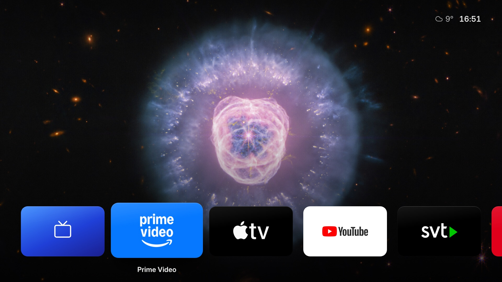
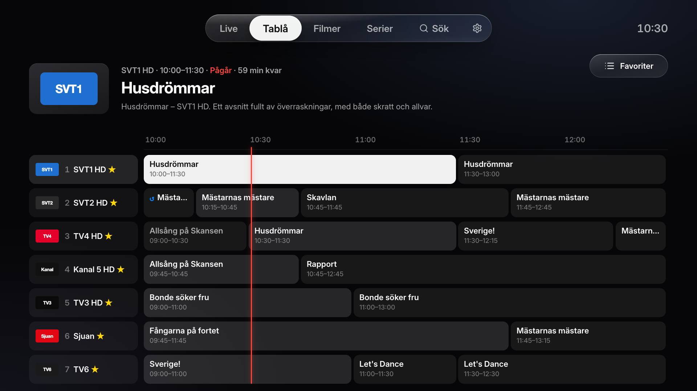
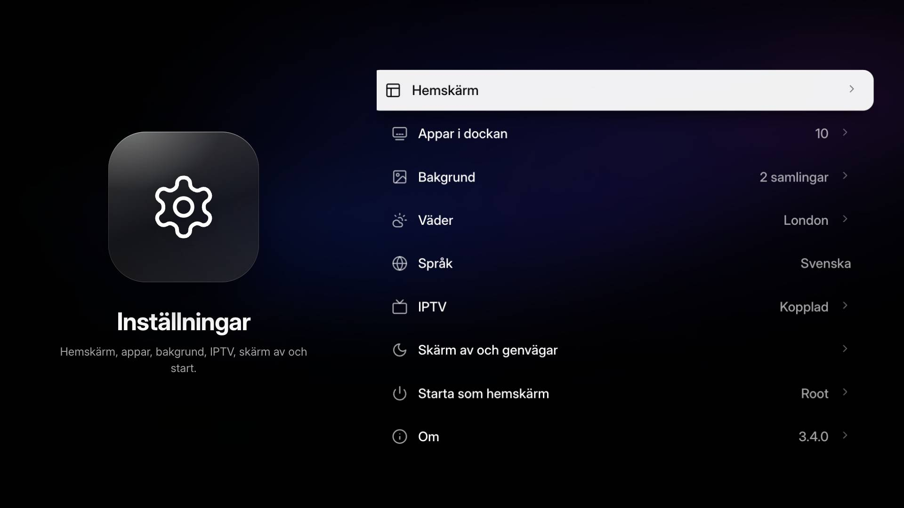

# iptvOS

**iptvOS** är en egen hemskärm för LG webOS-TV i tvOS 26-stil ("Liquid Glass"), med inbyggd IPTV (Live, tablå, filmer, serier, sök) och en valfri hubb som körs på din egen server. Den ersätter LG:s hemskärm på en rootad TV. Gränssnittet finns på **svenska** och **engelska** och följer TV:ns språk.

**[English](README.md)** · [Arkitektur](docs/ARCHITECTURE.md) · [Hubben](hub/README.sv.md) · [För AI-agenter](AGENTS.md)







> **Inget innehåll ingår.** Det här är en hemskärm och en spelare. Inga kanaler, spellistor eller strömmar följer med, och projektet länkar inte till några. För IPTV behöver du ett eget abonnemang hos en leverantör du får använda. Att roota en TV sker på egen risk och kan påverka garantin.

## Delar

| Del | Var | Vad |
| --- | --- | --- |
| **Launchern** | `apps/launcher` | Hemskärmen, TV-appen och inställningarna (webbapp på TV:n) |
| **Tjänsten** | `apps/launcher/service` | Körs som root på TV:n: applista, HDMI-ingångar, ikoner, start vid påslag, påminnelser |
| **Hubben** (valfri) | `hub/` | IPTV-hjärnan på en liten server, t.ex. en Proxmox-LXC: spellistor, urval av kategorier, favoriter, sök, omslag och webbadmin. Se [hub/README.sv.md](hub/README.sv.md). |

## Det här behöver du

### TV:n

- **En LG webOS-TV.** Utvecklad och testad på en LG OLED G3 (OLED65G36LA) med aktuell firmware. Andra nyare LG-TV med webOS fungerar troligen, men är inte testade.
- **Root och Homebrew Channel.** Launchern ersätter LG:s hemskärm, startar när TV:n slås på och läser TV:ns riktiga applista och ingångar. Det tillåter LG bara för appar med root, så TV:n måste vara rootad och ha [Homebrew Channel](https://github.com/webosbrew/webos-homebrew-channel) installerad.

  Projektet rootar inte TV-apparater och beskriver inte hur man gör. Om en TV går att roota beror på modell och firmware, och metoderna ändras med tiden. Använd webOS Homebrew-projektets egna, aktuella sidor:

  | Fråga | Var |
  | --- | --- |
  | Går min TV att roota? | [CanI.RootMy.TV](https://cani.rootmy.tv/) kontrollerar modell och firmware |
  | Hur rootar jag den? | [webosbrew.org/rooting](https://www.webosbrew.org/rooting/), den officiella guiden |
  | Vad är Homebrew Channel? | [webosbrew.org](https://www.webosbrew.org/) och [dess GitHub-sida](https://github.com/webosbrew/webos-homebrew-channel) |

- **SSH i Homebrew Channel.** Slå på SSH-servern i Homebrew Channels inställningar. Installationen och engångssteget för root körs via SSH som `root` på port 22. Lösenord eller nyckel ställer du in enligt Homebrew Channels beskrivning.
- **TV:ns IP-adress.** Ge TV:n en fast adress i routern, så att datorn och hubben alltid hittar den.

### Homebrew-appar

Installeras från Homebrew Channel på TV:n.

| App | Behövs? | Till vad |
| --- | --- | --- |
| **Homebrew Channel** | Krävs | Root, SSH och startskript (`init.d`). Launcherns bevakare ligger där. |
| **[LG Input Hook](https://repo.webosbrew.org/apps/org.webosbrew.inputhook)** (`org.webosbrew.inputhook`) | Rekommenderas | Får fjärrkontrollens **Hem**-knapp att öppna launchern i stället för LG:s hemskärm. Används också för en valfri knapp för Skärm av som fungerar i alla appar. |

### På datorn

- **Node.js 18 eller senare** med npm, och git. Används för att bygga, testa och installera.
- **[webOS Dev Manager](https://github.com/webosbrew/dev-manager-desktop)** (valfritt). Lägger du till TV:n där (användare `root`, port 22) hittar `npm run tv` den av sig själv. Utan den kör du `npm run tv -- setup <tv:ns-ip> root` en gång.
- **Google Chrome** (valfritt) för `npm test`, som kör gränssnittet i en webbläsare utan fönster.

### För IPTV (valfritt)

Launchern fungerar som hemskärm helt utan IPTV. För TV-appen behöver du något av:

- **Ett Xtream Codes-konto** från din leverantör (server, användarnamn, lösenord). Fungerar både med och utan hubb.
- **En adress till en M3U-spellista.** Kräver hubben.

Hubben behöver en liten dator som alltid är på i nätverket, med Node.js 18 eller senare, till exempel en Proxmox-container (skript följer med), en Raspberry Pi eller en NAS.

## Med eller utan hubb

| | Utan hubb (direkt) | Med hubb |
| --- | --- | --- |
| Hemskärm, appar, ingångar, inställningar, bakgrunder, vila | ✓ | ✓ |
| Live-TV, tablå, catch-up, påminnelser | ✓ | ✓ |
| Filmer och serier, "Fortsätt titta", sök | ✓ | ✓ |
| Typ av leverantör | Xtream Codes | Xtream Codes och M3U, flera spellistor |
| Välja kategorier och favoriter | På TV:n | På TV:n och i webbadmin, gemensamt för alla TV-apparater |
| Mycket stora spellistor (20 000+ kanaler) | TV:n hämtar och sorterar allt | Hubben cachar, TV:n hämtar bara det du visar |
| Omslag till titlar som saknar bild (TMDB) | – | ✓ (med en gratis TMDB-nyckel) |
| Undertexter i `.mkv` ritade av launchern | – (TV:ns egna undertexter) | ✓ |
| Samlingar av bakgrundsbilder | Glas och en liten rymdsamling | Ungefär 3 600 bilder till i sex samlingar |
| Flygfilmer i vilan | – | ✓ |

Börja utan hubb om du har ett Xtream Codes-konto och en spellista av normal storlek. Hubben kan du lägga till senare. Under Inställningar › IPTV väljer du **Hubb** eller **Direkt**.

## Installera

Steg 1–3 installerar launchern. Steg 4–6 är valfria.

1. **Hämta koden och installera verktygen:**
   ```bash
   git clone https://github.com/Creazawolf/iptvOS.git
   cd iptvOS
   npm install
   ```
2. **Anslut till TV:n.** Lägg till den i webOS Dev Manager (användare `root`, port 22), eller kör:
   ```bash
   npm run tv -- setup 192.168.1.50 root     # TV:ns IP-adress
   npm run tv -- device                      # visar vilken TV som används
   ```
   Har du flera TV-apparater väljer du med `TV_DEVICE=<namn>`.
3. **Installera och ge tjänsten root (en gång).** Appen heter **iptvOS** i LG:s applista.
   ```bash
   npm run deploy          # bygg, installera via SSH och starta
   npm run tv -- root      # en gång: root och start vid påslag
   ```
   `npm run tv -- root` lägger ett litet bevakarskript i Homebrew Channels `init.d`. Det låter Homebrew Channel lyfta launcherns tjänst till root, vilket en vanlig utvecklarapp inte kan, och gör det igen efter varje omstart och ominstallation. Det startar också launchern när TV:n slås på eller vaknar ur standby. Utan dator kan du köra kommandot som visas under Inställningar › Starta som hemskärm som root på TV:n via SSH.
4. **Hem-knappen (rekommenderas).** Installera **LG Input Hook** från Homebrew Channel. Bind **Hem**-knappen till *Execute* med kommandot nedan, som också står under Inställningar › Starta som hemskärm › Hem-knappen:
   ```sh
   luna-send -n 1 luna://com.webos.applicationManager/launch '{"id":"com.g3custom.launcher","keepAlive":true}'
   ```
   `keepAlive` ber TV:n att inte stänga launchern när minnet är trångt, så att Hem-knappen hittar den varm. Bevakaren startar LG Input Hook efter varje omstart, eftersom den inte gör det själv. Säger Input Hook att root saknas: se [Felsökning](#felsökning).
5. **IPTV.** Öppna Inställningar › IPTV på TV:n:
   - **Direkt:** ange server, användarnamn och lösenord för ditt Xtream Codes-konto.
   - **Hubb:** sätt först upp hubben ([hub/README.sv.md](hub/README.sv.md)). Ange sedan dess adress, till exempel `http://192.168.1.20:8787`. Spellistor, kategorier och favoriter sköter du i hubbens webbadmin.
6. **Skärm av från alla appar (valfritt).** Under Inställningar › Skärm av och genvägar › Knapp för Skärm av trycker du på den knapp du vill använda. Från datorn visar `npm run tv -- key` koden för nästa knapp du trycker på, och `npm run tv -- key <kod>` binder den. Kräver LG Input Hook.

`npm run tv -- status` visar läget på TV:n: root, bevakaren, LG Input Hook och vilken app som är i förgrunden.

**Språk.** Gränssnittet följer TV:ns menyspråk: svenska om TV:n är inställd på svenska, annars engelska. Du ändrar det under Inställningar › Språk. Hubbens webbadmin följer webbläsaren, och där kan du också byta.

**Egna standardval.** Kopiera `apps/launcher/config.local.example.js` till `apps/launcher/config.local.js` för egna standardval, till exempel väderort, appar i dockan eller IPTV-uppgifter. Filen checkas inte in men följer med när du installerar. Det du ändrar på TV:n sparas på TV:n och vinner över båda filerna.

**Stäng av eller ta bort.** Stäng av "Starta vid påslag" i inställningarna, så behåller tjänsten root men launchern startas inte automatiskt. Vill du ta bort allt kör du som root på TV:n:
```sh
sh /var/lib/webosbrew/init.d/90-g3custom stop; rm /var/lib/webosbrew/init.d/90-g3custom
```
Avinstallera sedan appen på TV:n eller med webOS Dev Manager.

## Hemskärmen

- **Dockan** överst innehåller dina favoritappar och ingångar. Du väljer dem under Inställningar › Appar i dockan, eller genom att hålla in OK på en app.
- **Top shelf** visar bakgrundsbilden. På TV-rutan visas i stället en tyst förhandsvisning av senaste kanalen med "Fortsätt titta". Appar som har en egen bild visar den.
- **Raderna under dockan** är Kanaler (dina favoritkanaler och vad som går nu), Fortsätt titta (filmer och avsnitt) och Alla appar (alla installerade appar och HDMI-ingångar). Under Inställningar › Hemskärm väljer du vilka rader som syns och i vilken ordning.
- **Riktiga appar och logotyper.** Applistan kommer från TV:n, och ikonerna är apparnas egna i högsta upplösningen. HDMI-enheter får skarpa logotyper (PlayStation, SHIELD, Xbox …) och namnet från TV:n, till exempel "PS5".
- **Klocka och temperatur** syns diskret uppe till höger. Väderorten väljer du under Inställningar › Väder.
- **Bakgrunder.** Välj en eller flera samlingar under Inställningar › Bakgrund – de blandas. Glas (abstrakta glasbilder, ligger i appen) finns alltid. Med hubben tillkommer ungefär 3 600 bilder: Rymden (Webb, Hubble och ESO, CC BY 4.0), Jorden från ovan (Google Earth View), Natur och landskap och Utvalda bilder (Wikimedia Commons, fotografen namnges), Dagens bild (Bing) och Fotografier (Chromecasts bakgrundsbilder). Hubben skickar en bild i taget i 1 920 px, så TV:n gör inget tungt arbete.
- **Vila.** Efter en stund utan knapptryck glider bakgrunden långsamt och en dämpad klocka visas. Under Inställningar › Bakgrund kan du i stället välja **Flygfilmer**: långsamma flygningar över natur, städer, hav och jorden från rymden, med platsens namn och bildtexter. Listorna kommer från projektet [Aerial Views](https://github.com/theothernt/AerialViews). Filmerna strömmas i 1080p, 4K eller 4K Dolby Vision och sparas inte. Efter en timme tar bilderna över, så att en TV som står på inte strömmar film i onödan. Första knapptrycket avslutar.
- **Prestandaläge** under Inställningar › Hemskärm stänger av glasoskärpa och glans.
- **Skärm av** släcker bilden men låter ljudet fortsätta, för musik och poddar. Rutan finns bland apparna och i dockan.
- **LG webOS** är en ruta som öppnar LG:s egen hemskärm. Hem-knappen tar dig tillbaka.

## TV-appen

- **Inget byts av sig självt.** På flikraden (Live · Tablå · Filmer · Serier · Sök) flyttar ◀ ▶ bara markören; OK eller ▼ öppnar fliken. I kanallistan bläddrar du fritt: OK spelar kanalen i rutan och OK en gång till ger helskärm. Vill du ha det som förr ändrar du det under kugghjulet › Navigering.
- **Kugghjulet** sist i flikraden öppnar TV-appens inställningar: källa, navigering, live-TV, filmer och serier, ljud och undertexter, påminnelser och rensning.
- **Live** med kanallista, tablå och helskärm. Håller du in ▲▼ startas bara kanalen du stannar på. Kanalnummer byter direkt när numret är entydigt.
- **Catch-up:** på kanaler där leverantören sparar sändningar visas passerade program med ↺ i tablån. OK spelar dem, och *Se från början* finns för pågående program (håll in OK).
- **Påminnelser:** OK på ett kommande program i tablån eller i sökträffarna. En minut innan visas en ruta på TV:n, även om du tittar på något annat. *Titta nu* byter kanal.
- **Sök** hittar kanaler, filmer, serier och program i tablån.
- **Filmer och serier** fortsätter där du slutade och spelar nästa avsnitt. TV:n spelar filerna med sin egen avkodare, så 4K, HDR10, HLG, Dolby Vision, Dolby Atmos och DTS fungerar när filen har det. Ljudspår och undertexter väljs med grön knapp, där du också ändrar textens storlek, höjd, bakgrund och synk.
- **Tillbaka** från något du startat på hemskärmen går till TV-appen. Tillbaka en gång till går till hemskärmen.

Knappar i helskärm (live):

| Knapp | |
| --- | --- |
| ▲ ▼ / CH± | Byt kanal (eller bläddra och byt med OK, se Navigering) |
| OK / ◀ | Kanallistan ovanpå bilden |
| Blå | Föregående kanal |
| Grön | Ljud och undertexter |
| Röd | Alternativ: bildformat, insomningstimer, skärm av, påminnelse om nästa program |
| Gul | Favorit |
| 0–9 | Kanalnummer |

I filmspelaren är grön Ljud och undertexter och röd Alternativ.

Knappar på hemskärmen:

| Knapp | |
| --- | --- |
| Håll in OK | Meny: lägg till eller ta bort i dockan, flytta, göm |
| Tillbaka | Upp till dockan |
| Blå | Hoppa till Alla appar |

## Utveckling

```bash
npm install
npm run dev        # http://localhost:8080 – launchern + en lokal hubb med demodata
```

I webbläsaren används applistan och ikonerna från din TV om de finns i `build/dev-fixtures/`, annars en tom lista. Lägg till `?noroot` i adressen för att se hur det ser ut utan root.

| Tangent | Motsvarar |
| --- | --- |
| Piltangenterna | Navigera |
| Enter | OK (håll in för meny) |
| Esc | Tillbaka |
| R, G, Y, B | Färgknapparna |
| PgUp, PgDn | Kanal upp och ned |
| 0–9 | Siffror |

**Översättningar.** All text i launchern går genom `tr('nyckel')`. Ordlistorna är `apps/launcher/js/i18n/en.js` och `sv.js`, och hubben har egna i `hub/web/i18n/` och `hub/lib/locales/`. `npm run i18n:check` kontrollerar att varje nyckel finns på alla språk. Nytt språk: kopiera `en.js`, översätt, lägg till en `<script>`-tagg i `apps/launcher/index.html` och en rad i `LANGS` i `apps/launcher/js/core/i18n.js`.

Kommandon, mappstruktur och felsökning står i den [engelska README:n](README.md#commands).

## Licens

[MIT](LICENSE). Typsnitt, ikoner och logotyper från andra har sina egna licenser, se [THIRD_PARTY_NOTICES.md](THIRD_PARTY_NOTICES.md). LG, webOS och de app- och varumärkesnamn som visas tillhör sina ägare. Projektet har ingen koppling till LG.

## Tack till

[Inter](https://rsms.me/inter/) (SIL OFL) · ikoner från [Lucide](https://lucide.dev) (ISC) · märken från [Simple Icons](https://simpleicons.org) (CC0) · rymdbilder från ESA/Webb, NASA & CSA och ESA/Hubble & NASA (CC BY 4.0) · väder från [Open-Meteo](https://open-meteo.com) · listor över flygfilmer från [Aerial Views](https://github.com/theothernt/AerialViews) · [webOS Homebrew-projektet](https://www.webosbrew.org/)
